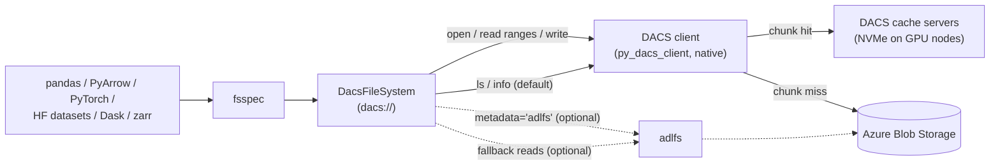

# dacs-fsspec

**Read Azure Blob data through the [DACS](https://github.com/Azure/dacs) NVMe cache from anything that speaks [fsspec](https://filesystem-spec.readthedocs.io/): pandas, PyArrow, PyTorch, Hugging Face `datasets`, Dask, zarr. Change the URL, keep your code.**

[](https://github.com/cb-Sigma/dacs-fsspec/actions/workflows/ci.yml)
[](LICENSE)
[](pyproject.toml)
[](#how-this-is-tested-and-what-is-not)

```python
# before: straight to Azure Blob Storage with adlfs
df = pd.read_parquet("abfs://datasets@myaccount.dfs.core.windows.net/train/part-0.parquet")

# after: the same blob, served from the DACS cache on your GPU nodes
df = pd.read_parquet("dacs://myaccount/datasets/train/part-0.parquet")
```

> [!IMPORTANT]
> **Unofficial community project.** dacs-fsspec is not affiliated with, endorsed by, or supported by Microsoft. "DACS" and "Azure" are used only to describe what this adapter connects to.
>
> **DACS itself is pre-release.** Its maintainers describe it as under active development with APIs and configuration subject to change, and its current security model assumes a **single trust domain equal to the whole Kubernetes cluster**: it is not suitable for multi-tenant clusters. Read the upstream [security model](https://github.com/Azure/dacs/blob/main/docs/security-model.md) before deploying it.
>
> **This adapter has not been run against a live DACS cluster yet.** It is developed against the real client's source and wheel and tested with an in-memory fake. See [how this is tested, and what is not](#how-this-is-tested-and-what-is-not).

## Why

DACS (Distributed Accelerator for Cloud Storage) is a Kubernetes cache that keeps blob chunks on node-local NVMe in front of Azure Blob Storage, for model weights, datasets and checkpoints. Its Python client, [`dacs-client`](https://pypi.org/project/dacs-client/), ships adapters shaped like `blobfile` and `boostedblob`. Most of the Python data ecosystem speaks fsspec instead. This package is the missing adapter: a `DacsFileSystem` registered under the `dacs://` protocol.

## Install

dacs-fsspec is **not on PyPI yet**. Until the first tagged release, install from GitHub:

```bash
pip install "git+https://github.com/cb-Sigma/dacs-fsspec"

# with extras
pip install "dacs-fsspec[client,adlfs] @ git+https://github.com/cb-Sigma/dacs-fsspec"
```

Once the first release is tagged this becomes `pip install dacs-fsspec`.

| Extra | Adds | Needed for |
| --- | --- | --- |
| `client` | [`dacs-client`](https://pypi.org/project/dacs-client/) | Actually talking to DACS. Linux only (x86_64/aarch64, glibc 2.35+). |
| `adlfs` | [`adlfs`](https://github.com/fsspec/adlfs) | `metadata="adlfs"` and fallback reads straight from Azure Blob. |
| `torch` | `torch` | The `dacs_fsspec.torch` helpers. |
| `all` | `dacs-client` + `adlfs` | |

Requires Python 3.10+ and fsspec 2024.12.0+. The DACS client itself declares Python 3.8+, but current fsspec and adlfs require 3.10, so 3.10 is the honest floor.

The package installs and imports on any platform (so you can develop and unit-test on a laptop), but reads only reach DACS where `dacs-client` imports, which today means Linux.

## Quick start

```python
import fsspec

# open, read, seek: a buffered, read-ahead file object backed by the cache
with fsspec.open("dacs://myaccount/models/llama/model.safetensors", "rb") as f:
    header = f.read(8)

fs = fsspec.filesystem("dacs")
fs.ls("dacs://myaccount/datasets/train/")
fs.glob("dacs://myaccount/datasets/train/*.parquet")
fs.cat_file("dacs://myaccount/datasets/train/part-0.parquet", start=-8)  # last 8 bytes
fs.get("dacs://myaccount/models/llama/", "/local/llama/", recursive=True)
```

Check a pod's setup without writing any code:

```bash
python -m dacs_fsspec doctor                       # effective config, env, does the client import?
python -m dacs_fsspec doctor --probe dacs://myaccount/datasets/train/part-0.parquet
python -m dacs_fsspec ls -l dacs://myaccount/datasets/train/
python -m dacs_fsspec stat dacs://myaccount/datasets/train/part-0.parquet
python -m dacs_fsspec cat dacs://myaccount/datasets/readme.txt
python -m dacs_fsspec cp dacs://myaccount/models/llama/model.safetensors /tmp/model.safetensors
```

## URLs

```
dacs://<account>/<container>/<path/to/blob>
dacs://<account>.blob.core.usgovcloudapi.net/<container>/<blob>     # sovereign / custom clouds: full host
```

The DACS client addresses blobs as `az://<account>/<container>/<blob>` (the `blobfile` convention). adlfs *also* registers `az://`, but there it means `az://<container>/<blob>` with the account in `storage_options`. Same scheme, different meaning. Registering `az://` here would both collide with adlfs and silently reinterpret existing URLs, so this package uses its own `dacs://` scheme with the client's account-first layout, and refuses bare `az://`/`abfs://` paths with a pointer to the converters:

| You have | It becomes | Converter |
| --- | --- | --- |
| `az://acct/cont/blob` (blobfile, boostedblob, DACS client) | `dacs://acct/cont/blob` | `from_blobfile_url(url)` |
| `https://acct.blob.core.windows.net/cont/blob` | `dacs://acct/cont/blob` | accepted directly, or `from_blobfile_url(url)` |
| `az://cont/blob` or `abfs://cont/blob` + `account_name="acct"` (adlfs) | `dacs://acct/cont/blob` | `from_adlfs_url(url, account_name="acct")` |
| `abfs[s]://cont@acct.dfs.core.windows.net/blob` (adlfs, Spark) | `dacs://acct/cont/blob` | `from_adlfs_url(url)` |

```python
from dacs_fsspec import BlobPath, from_adlfs_url

from_adlfs_url("abfss://datasets@myaccount.dfs.core.windows.net/train/part-0.parquet")
# 'dacs://myaccount/datasets/train/part-0.parquet'

BlobPath.parse("dacs://myaccount/datasets/train/part-0.parquet").https_url
# 'https://myaccount.blob.core.windows.net/datasets/train/part-0.parquet'
```

## How it works



- **Data reads** (`open`, `read`, `cat_file`, `cat_ranges`, `get_file`) are positional reads on a DACS client handle, so they hit the cache. On a chunk miss the *client* reads from Azure Blob Storage and populates the cache; that is upstream behaviour, not something this adapter does.
- **Metadata** (`ls`, `info`, `exists`, and through them `glob`, `find`, `walk`, `du`) uses the client's `stat` and `list_dir` by default. The client has no glob or walk; fsspec builds those from `ls`. Pass `metadata="adlfs"` to ask Azure Blob Storage directly instead (richer info such as ETags, and one flat listing call per `ls`).
- **Writes** go through the client in the write mode you choose and are off by default.
- **File objects** use fsspec's read-ahead buffer (8 MiB blocks by default) over a single native handle, so many small reads become a few large ones.
- **Processes**: the filesystem never holds a client until first use, and the client is never pickled or shared across `fork`. Every DataLoader or Dask worker lazily builds its own.

## Configuration

### Filesystem options

Pass these as keyword arguments to `DacsFileSystem(...)` / `fsspec.filesystem("dacs", ...)`, or as `storage_options={...}` in pandas, Dask and friends.

| Option | Default | Meaning |
| --- | --- | --- |
| `write_mode` | `"disabled"` | `"disabled"`, `"sync"`, `"blob_only"`, `"cache_only"`, `"cache_blob_async"`. See [writes](#writes). |
| `consistent_mode` | `False` | Enable the client's consistent mode, which is what permits overwriting an existing blob. Only valid with `"sync"` and `"blob_only"`. |
| `metadata` | `"dacs"` | `"dacs"` (client `stat`/`list_dir`), `"adlfs"` (Azure Blob directly), or any object with `info(path)` and `ls(path)`. |
| `fallback` | `None` → off | `True` reads directly from Azure Blob (via adlfs) when DACS is unavailable. `None` reads `DACS_FSSPEC_FALLBACK`. See [fallback](#fallback). |
| `fallback_retry_seconds` | `60` | While in fallback, try DACS again after this long. `None` stays in fallback for the life of the process. |
| `blob_options` | mirrors the client | `storage_options` handed to adlfs when it is used. By default credentials follow the client's own order (below). |
| `client_factory` | real client | `factory(write_mode_value, consistent_mode) -> client`. For tests and custom wiring. Must be picklable to cross process boundaries. |
| `block_size` | `8 * 2**20` | Read-ahead / write buffer size of file objects. |
| `cache_type` | `"readahead"` | Any fsspec cache: `"readahead"` suits sequential reads, `"bytes"` or `"background"` suit Parquet-style random access, `"none"` disables buffering. |

### Environment variables read by the DACS client

These are the client's settings, not this package's; they are listed here because they decide whether you get a cache at all. Verified against `py_dacs_client/dacs_utils.py` (`_initialize_dacs_client_config`) and the client README.

| Variable | Effect |
| --- | --- |
| `CACHE_DISCOVERY_URL` + `CACHE_SERVER_PORT` | Discover cache servers dynamically. Takes precedence over the static list. |
| `CACHE_SERVER_LIST` + `CACHE_SERVER_PORT` | Static comma-separated cache servers. |
| *(neither pair set)* | **No cache.** The client logs "Working in Remote Blob mode only" and reads straight from Azure Blob Storage. Everything still works; nothing is accelerated. `doctor` flags this. |
| `USE_SAS_TOKEN=true` + `STORAGE_INTCPT_SAS_TOKEN` | Authenticate with a SAS token (development). Both are required. |
| `SI_azBlobAccessToken` | Authenticate with a pre-fetched access token. |
| `AZURE_CLIENT_ID` + `MSI_ENDPOINT` + `MSI_SECRET` | Managed identity through the given endpoint. All three are required. |
| *(none of the above)* | Azure Identity SDK default credential chain. |
| `STORAGE_INTERCEPT_CONFIG_FILEPATH` | A caller-owned native config file. If set it owns **all** settings, including write and consistent mode; the `write_mode`/`consistent_mode` options here then have no effect on the native layer. |
| `AZURE_BLOB_ENDPOINT_SUFFIX` | Extra trusted blob endpoint suffix for custom clouds. |
| `DACS_DATA_LOG_LEVEL` | Client log level (default `INFO`). |

Authentication is resolved in the order shown: SAS token, access token, managed identity, Azure Identity SDK.

When this package talks to Azure Blob Storage itself (`metadata="adlfs"` or fallback), it follows the same order so both paths act as the same principal: SAS token → `sas_token`, access token → a static bearer credential, otherwise adlfs with `anon=False` (`DefaultAzureCredential`, which honours `AZURE_CLIENT_ID`). Set `blob_options` to override. A custom `MSI_ENDPOINT` token proxy is the one case that may not carry over exactly, since `DefaultAzureCredential` has its own rules for those variables.

### Environment variable read by this package

| Variable | Effect |
| --- | --- |
| `DACS_FSSPEC_FALLBACK` | `1`/`true`/`yes`/`on` turns fallback on for filesystems that do not set `fallback` explicitly. Read when the filesystem is created. |

## Recipes

### pandas and PyArrow

```python
import pandas as pd

df = pd.read_parquet(
    "dacs://myaccount/datasets/train/part-0.parquet",
    storage_options={"cache_type": "bytes"},  # Parquet seeks around; keep what was read
)

import pyarrow.dataset as ds
from pyarrow.fs import FSSpecHandler, PyFileSystem
from dacs_fsspec import DacsFileSystem

dataset = ds.dataset(
    "myaccount/lake/events",
    filesystem=PyFileSystem(FSSpecHandler(DacsFileSystem())),
    format="parquet",
)
```

### PyTorch DataLoader

```python
import fsspec
from torch.utils.data import DataLoader
from dacs_fsspec.torch import BlobDataset

fs = fsspec.filesystem("dacs")
urls = [fs.unstrip_protocol(p) for p in fs.find("dacs://myaccount/datasets/shards/")]

dataset = BlobDataset(urls, transform=decode_sample)  # decode_sample(bytes) -> sample
loader = DataLoader(dataset, batch_size=64, num_workers=8, multiprocessing_context="spawn")
```

`BlobDataset` carries only URLs and options; each worker builds its own client on first read. Prefer `spawn` or `forkserver`: forked children do get a fresh client here, but forking a process that has already initialised *any* native library with threads is the usual hazard.

### Model weights: safetensors and `torch.load`

```python
from dacs_fsspec.torch import load_safetensors, torch_load

state = load_safetensors("dacs://myaccount/models/llama/model.safetensors", device="cuda:0")
ckpt = torch_load("dacs://myaccount/checkpoints/step-10000.pt", map_location="cpu", weights_only=True)
```

`load_safetensors` reads the whole file into host memory and deserialises it (peak memory roughly twice the file size). To pull the file onto local disk once and memory-map it instead:

```python
import fsspec
from safetensors.torch import load_file

fsspec.filesystem("dacs").get_file("dacs://myaccount/models/llama/model.safetensors", "/nvme/model.safetensors")
state = load_file("/nvme/model.safetensors", device="cuda:0")
```

### Hugging Face `datasets`

```python
from datasets import load_dataset

ds = load_dataset(
    "parquet",
    data_files="dacs://myaccount/corpus/*.parquet",
    split="train",
    streaming=True,  # read through the cache instead of copying into ~/.cache/huggingface first
)
```

### Dask

```python
import dask.dataframe as dd

ddf = dd.read_parquet("dacs://myaccount/lake/events/*.parquet", storage_options={"cache_type": "bytes"})
```

Workers need `dacs-client` installed and the same `CACHE_*` and credential environment variables as the client.

### zarr (v3)

```python
import zarr
from fsspec.implementations.asyn_wrapper import AsyncFileSystemWrapper
from zarr.storage import FsspecStore
from dacs_fsspec import DacsFileSystem

fs = AsyncFileSystemWrapper(DacsFileSystem(), asynchronous=True)
array = zarr.open_array(FsspecStore(fs, path="myaccount/arrays/grid.zarr", read_only=True), mode="r")
```

### WebDataset

WebDataset opens URLs through its own scheme table rather than fsspec, so register the scheme once:

```python
import fsspec, webdataset as wds

fs = fsspec.filesystem("dacs")
wds.gopen_schemes["dacs"] = lambda url, mode="rb", bufsize=8192, **kw: fs.open(url, mode)

dataset = wds.WebDataset("dacs://myaccount/shards/train-{0000..0099}.tar", shardshuffle=100)
```

### Testing your own pipeline without a cluster

```python
from dacs_fsspec import DacsFileSystem
from dacs_fsspec.testing import FakeDacs

fake = FakeDacs({"dacs://acct/data/a.csv": b"x,y\n1,2\n"})
fs = DacsFileSystem(client_factory=fake)
assert fs.cat_file("dacs://acct/data/a.csv") == b"x,y\n1,2\n"
```

`examples/offline_demo.py` runs entirely on this fake.

## Writes

Writing is disabled unless you ask for it, mirroring the client (whose default write mode is "no writes").

| `write_mode` | Client `WriteMode` | Behaviour (as documented upstream) |
| --- | --- | --- |
| `"disabled"` (default) | `WRITE_DISABLED` | Read-only. `open(..., "wb")` raises `OSError` (`EROFS`). |
| `"sync"` | `WRITE_SYNC` | Write to cache and blob synchronously. |
| `"blob_only"` | `WRITE_BLOB_ONLY` | Write to the blob, bypassing the cache. |
| `"cache_only"` | `WRITE_CACHE_ONLY` | Write to the cache only; **nothing reaches Azure Blob Storage**. |
| `"cache_blob_async"` | `WRITE_CACHE_BLOB_ASYNC` | Write to the cache, upload to the blob in the background. |

```python
fs = fsspec.filesystem("dacs", write_mode="sync")
with fs.open("dacs://myaccount/checkpoints/step-10000.pt", "wb") as f:
    torch.save(state, f)
```

What to know:

- **New blobs only, by default.** Without consistent mode the client cannot overwrite, so `"wb"` on an existing blob raises `FileExistsError`. `consistent_mode=True` (with `"sync"` or `"blob_only"`) enables overwriting.
- **The blob is committed when the file is closed.** A write that fails mid-way leaves whatever the client leaves; there is no transaction support.
- **Memory.** The native layer may reference write buffers until the handle is closed, so every written chunk is held in memory until `close()`. Peak memory is about the size of the object being written.
- **One write configuration per process.** The native client keeps process-global configuration. Creating filesystems with different `write_mode`s in the same process makes the most recent one win; a warning is logged.
- No append, no delete, no rename, no server-side copy: see the table below.

## Fallback

The cache is an accelerator, not the source of truth, so a broken accelerator does not have to break the job:

```python
fs = fsspec.filesystem("dacs", fallback=True)  # or: export DACS_FSSPEC_FALLBACK=1
```

With fallback on, if the client cannot be imported or initialised, or a call fails with a connectivity-type error (connection refused/reset, unreachable, timeout, `EAGAIN`, or the client's unclassified `EIO`), reads and metadata go straight to Azure Blob Storage through adlfs. One `DacsFallbackWarning` is emitted per filesystem per process (and logged at `INFO` on the `dacs_fsspec` logger), and `fs.status()` reports `"azure-blob-direct"`. After `fallback_retry_seconds` DACS is tried again.

**Fallback is off by default**, on purpose: an accelerator that silently stops accelerating is a performance bug nobody notices, and fallback needs the extra `adlfs` dependency plus credentials that work for direct access. Turn it on deliberately, per job or per cluster via the environment variable.

"Not found", "permission denied" and other blob-level errors never trigger fallback, and writes never fall back.

Note the layering: the DACS client already falls back to Azure Blob Storage per chunk on a cache miss, and runs in pure "Remote Blob mode" when no cache servers are configured. This option covers what is left: the client being absent, unconfigurable, or erroring out.

## Supported operations

| Operation | Status | Notes |
| --- | --- | --- |
| `open(..., "rb")`, `read`, `seek`, `tell`, `readinto`, iteration, text mode | Yes | Through the cache. Read-ahead buffered. |
| `cat_file` (with `start`/`end`, negative offsets), `cat`, `cat_ranges`, `head`, `tail` | Yes | Through the cache. |
| `get_file`, `get` (recursive) | Yes | Streams in 32 MiB chunks. |
| `info`, `size`, `isfile`, `isdir`, `exists`, `modified` | Yes | Client `stat`, or adlfs. `exists` re-raises auth/connectivity errors instead of returning `False`. |
| `ls`, `glob`, `find`, `walk`, `du`, `expand_path` | Yes | `ls` is client `list_dir`; the rest is fsspec on top, one listing call per directory. |
| `fsspec.open`, `url_to_fs`, `open_files`, `get_mapper`, `simplecache::` chaining | Yes | |
| Pickling the filesystem and read-mode files | Yes | The client is recreated lazily in the receiving process. |
| `open(..., "wb")`, `pipe_file`, `put_file`, `put`, `write_text` | Opt-in | Needs a `write_mode`. New blobs only unless `consistent_mode=True`. |
| `open(..., "xb")`, `pipe_file(mode="create")` | Opt-in | Exclusive create. |
| `mkdir`, `makedirs` | No-op | Blob "directories" are implied by names. Containers are never created. |
| `open(..., "ab")` (append) | No | The client has no append. |
| `rm`, `rm_file`, `rmdir` | No | The client has no delete. Use adlfs against the blob. |
| `mv`, `copy`, `cp_file` | No | No rename or remote-to-remote copy in the client. |
| `touch`, `sign`, `created`, transactions (`autocommit=False`) | No | |
| Listing storage accounts (`ls("dacs://")`) | No | Start from `dacs://<account>/`. |
| Async filesystem API | No | Synchronous only; wrap with fsspec's `AsyncFileSystemWrapper` where an async filesystem is required (zarr v3). |

Unsupported operations raise `NotImplementedError` with a message saying why.

## Limitations

- **Linux only for real I/O**, because `dacs-client` ships Linux wheels (glibc 2.35+).
- **The client logs to stdout**, including native-layer lines at import time. If your program writes data to stdout, set `DACS_DATA_LOG_LEVEL` and be aware of it. The bundled CLI points fd 1 at stderr and writes its own output to a private copy of stdout so that `cat` and pipelines stay clean.
- **Importing the client has side effects**: the native layer writes a per-process `storageIntercept.<pid>.config` under `/tmp`. That is upstream behaviour.
- **Timeouts belong to the native client.** A call that blocks inside the native library cannot be interrupted from Python. In an environment with no route to Azure, a single `stat` was observed to block for several minutes. Fallback only starts once the client returns an error.
- **Freshness.** How quickly the cache notices that a blob changed in Azure is DACS behaviour; this adapter adds no caching of its own beyond the per-file read buffer, and no listings cache.
- **Blob names with `//`** are normalised to `/` and cannot be addressed.
- **No directory-level atomicity or locking**, as with any object store.
- **Listing very large prefixes** costs one `list_dir` per directory through the client; `metadata="adlfs"` may be faster for huge trees.
- **`stat` detail is minimal** with the default metadata backend: name, size, type, mtime. Use `metadata="adlfs"` for ETags and content settings.

## How this is tested, and what is not

Stated plainly: **this package has not been run against a live DACS cluster or a real Azure storage account.** The author had neither while writing it.

What is verified:

- **Against the real client's source.** Class names, method signatures, URL formats, environment variables, write modes and the exception hierarchy were taken from `py_dacs_client` in the DACS repository, not from memory.
- **Against the real `dacs-client` 0.1.0 wheel** (it imports on Linux x86_64, glibc 2.39, Python 3.13). A dedicated test module introspects the real classes so drift is caught: constructor and method signatures, `WriteMode` values, `Stat64` fields, that the URLs this package produces are already in the client's canonical form, that the exact ctypes buffer objects passed to `read_sync`/`write_sync` convert under the native functions' declared argument types, that real client exceptions translate to the right builtin exceptions, and that a real client object can be constructed. None of this performs I/O.
- **Filesystem semantics, against an in-memory fake** that implements the same ctypes-buffer interface and error style as the client: ranges, read-ahead, seek/tell, EOF, short native reads, missing blobs, writes and write modes, fallback and its retry window, pickling, `fork`/`spawn`/`forkserver` workers, URL parsing, the CLI. About 97% line and branch coverage.
- **fsspec consumers, against the same fake**: `fsspec.open`, `url_to_fs`, `fsspec.filesystem("dacs")`, pandas CSV and Parquet (read and write), PyArrow datasets, Dask DataFrame, Hugging Face `datasets` (streaming and eager), zarr v3, WebDataset, PyTorch `DataLoader` workers, `torch.load`, safetensors.
- **adlfs wiring**: the options passed to `AzureBlobFileSystem` are checked against its real signature and it is constructed offline. No request is ever sent.

What is **not** verified, and may be wrong:

- Any real read, write, `stat` or `list_dir` through the native library, and therefore actual cache hits.
- The fake's assumptions about native behaviour that the Python source does not pin down: what `stat` and `list_dir` return for virtual directories, containers and missing prefixes; whether `pread` at end of file returns short or errors (the adapter never asks for bytes past the reported size, to stay clear of it); the unit of `st_mtime` (assumed seconds); which errno a dead cache server produces.
- Write paths in every mode, overwrite under consistent mode, zero-length blobs, and the memory behaviour of large writes.
- Whether an errored cache surfaces as an exception (so fallback can act) or is already absorbed by the client's own blob fallback.
- Behaviour after `fork()` with the real native library loaded in the parent.
- Credential parity between the client and adlfs for managed identity through a custom `MSI_ENDPOINT`.
- Performance. No benchmark has been run; block sizes are educated defaults.
- Ray Data and `huggingface_hub` utilities, which were not exercised at all.
- Sovereign clouds, and macOS/Windows beyond "it installs and the fake-backed tests are expected to pass".

A live test module (`tests/test_live_integration.py`) is included and skipped by default:

```bash
DACS_FSSPEC_TEST_URL=dacs://account/container/some/blob \
DACS_FSSPEC_TEST_WRITE_PREFIX=dacs://account/container/scratch \
pytest -m integration
```

If you run it on a real cluster, please [open an issue](https://github.com/cb-Sigma/dacs-fsspec/issues) with the result, pass or fail. That is the single most useful contribution right now.

## FAQ

**Is this an official Microsoft or DACS project?**
No. It is an independent community adapter built on the public client.

**Why not just use adlfs?**
adlfs talks to Azure Blob Storage directly. That is the right tool when you have no cache. With DACS deployed, reads through the DACS client are served from NVMe on your nodes; this package lets fsspec-based code use that path.

**Why `dacs://` and not `az://`?**
`az://` already means two incompatible things (account-first in blobfile and the DACS client, container-first in adlfs). See [URLs](#urls).

**Do I need adlfs?**
No. Metadata comes from the DACS client by default. adlfs is only needed for `metadata="adlfs"` or `fallback=True`.

**How do I know reads are actually hitting the cache?**
This package cannot tell a hit from a miss; the client hides that. Check `python -m dacs_fsspec doctor` for configuration (it flags "no cache servers configured"), `fs.status()` for whether you are in fallback, and DACS's own metrics for hit rates.

**Does it work in DataLoader / Dask / Ray workers?**
The filesystem and read-mode files pickle, and each process lazily creates its own client; this is tested with `fork`, `spawn` and `forkserver` against the fake. Workers need `dacs-client` and the same environment as the driver.

**Can I mount a blob path or use it from non-Python tools?**
Not with this package. DACS has its own storage-interception layer for that.

**Which versions of the client are supported?**
Developed against `dacs-client` 0.1.0. The client is pre-release and may change; the signature tests are there to notice when it does.

## Roadmap

- Validation on a live cluster, and fixes for whatever that reveals.
- Benchmarks against adlfs and against the client's own adapters; tuned defaults for block size and cache type.
- First tagged release on PyPI.
- A listings cache and faster recursive `find`.
- Zero-copy `readinto` and parallel ranged reads for `cat_ranges`.
- Native async filesystem (the client has an async API).
- Ray Data and `huggingface_hub` recipes, once tested.

## Contributing

Issues and pull requests are welcome; see [CONTRIBUTING.md](CONTRIBUTING.md). Short version:

```bash
git clone https://github.com/cb-Sigma/dacs-fsspec && cd dacs-fsspec
python -m venv .venv && . .venv/bin/activate
pip install -e ".[dev,adlfs]"
ruff check . && ruff format --check . && mypy && pytest
```

Security reports: see [SECURITY.md](SECURITY.md).

## License

[Apache-2.0](LICENSE). DACS is a separate project, also Apache-2.0, copyright Microsoft Corporation; this repository contains none of its code.
